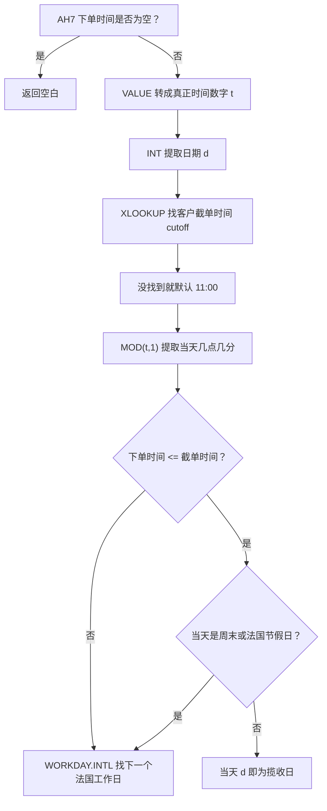
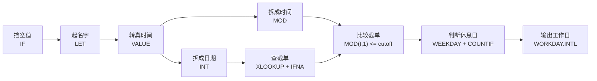
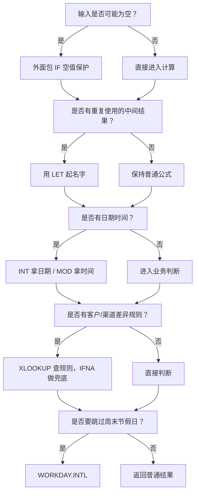
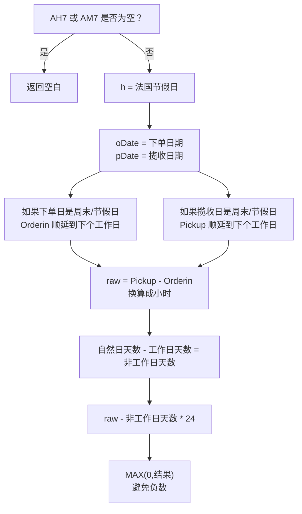
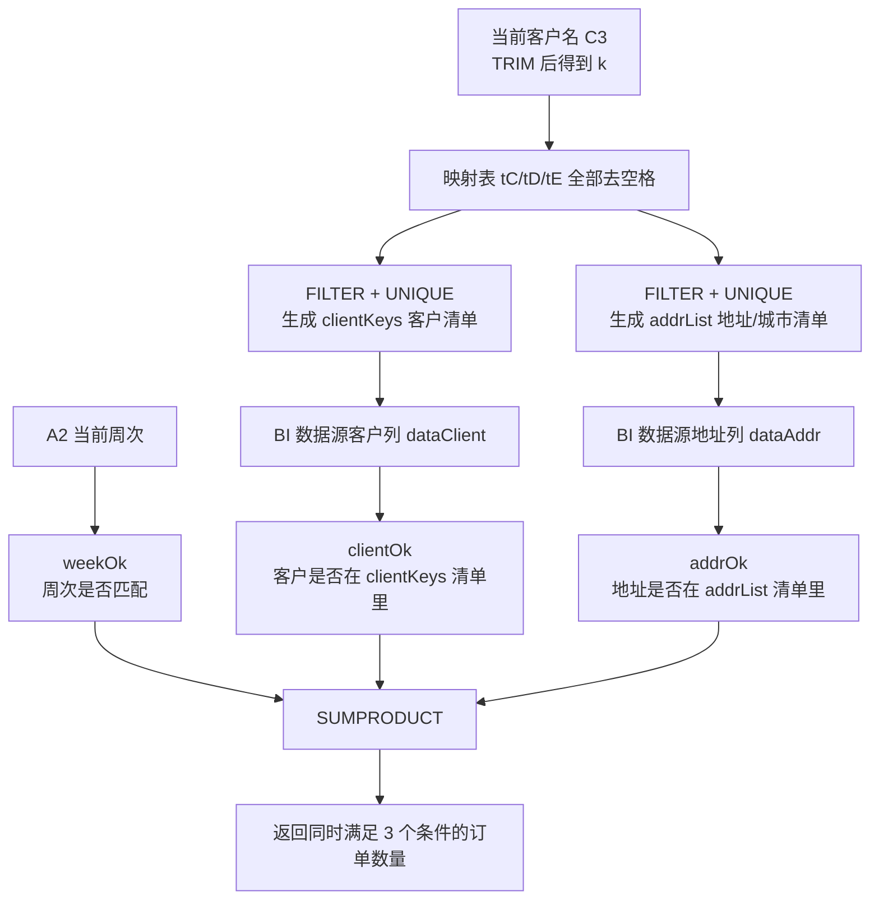
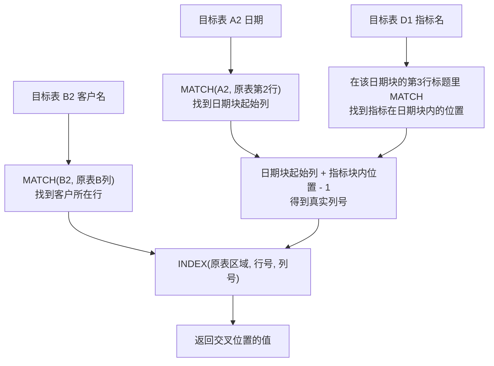

# Excel 公式经验库

这个经验库的目标不是“看懂一次”，而是让你以后遇到类似场景时，能自己把 3-4 个小公式组合成一个稳定的大公式。

## 使用方法

1. 先看“公式速记卡”：快速回忆这个函数解决什么问题。
2. 再看“参数拆解”：知道每个参数放什么。
3. 最后看“组合公式拆解”：学习怎么把小公式拼成大公式。

---

# 场景目录

| 场景 | 主题 | 重点函数/能力 |
|---|---|---|
| 场景 1 | 根据下单时间推算揽收时间 | `LET`、`VALUE`、`INT`、`MOD`、`WORKDAY.INTL` |
| 场景 2 | 自动生成 CIFR 业务编号 | `COUNTIFS`、`TEXT`、`INDEX + MATCH`、`VLOOKUP`、`IFERROR` |
| 场景 3 | 计算下单到揽收时效，剔除周末和节假日 | `NETWORKDAYS.INTL`、自然日、非工作日、小时差 |
| 场景 4 | 同名客户订单聚合：客户名称 + 下单城市双条件筛选 | `FILTER`、`UNIQUE`、`MATCH`、`SUMPRODUCT`、`ARRAYFORMULA` |
| 场景 5 | 改变表格呈现方式：从原表横向日期块取数到明细表 | `INDEX`、`MATCH`、嵌套 `INDEX`、二维定位 |
| 场景 6 | 渠道时效梯队分析：按客户和时效区间计数 | `COUNTIFS`、条件拼接、`"="&单元格` |
| 场景 7 | 动态引用工作表并统计唯一值 | `INDIRECT`、`SUBSTITUTE`、动态表名、`FILTER + UNIQUE + ROWS` |
| 场景 8 | 动态引用工作表并汇总逗号小数金额 | `INDIRECT`、`SUBSTITUTE`、`VALUE`、`FILTER`、`SUM` |

以后新增实战大公式时，每个场景都会按这个结构整理：

```text
业务目标 -> 原公式 -> 编号/逻辑组成 -> 小公式拆解 -> 图像记忆法 -> 大公式搭建方法 -> 主动自测
```

---

# 场景 1：根据下单时间推算揽收时间

## 业务目标

根据订单的下单时间，判断这个订单应该算当天揽收，还是顺延到下一个法国工作日揽收。

核心规则：

| 判断点 | 结果 |
|---|---|
| 下单时间为空 | 返回空 |
| 下单时间不晚于客户截单时间，且当天是工作日 | 当天揽收 |
| 下单时间不晚于客户截单时间，但当天是周末/法国节假日 | 下一个工作日揽收 |
| 下单时间晚于客户截单时间 | 下一个工作日揽收 |
| 客户没有单独设置截单时间 | 默认 11:00 截单 |

## 原公式

```excel
=IF(AH7="","",
LET(
 t,VALUE(AH7),
 d,INT(t),
 h,'法国节假日'!$A$2:$A,
 cutoff,IFNA(
  XLOOKUP(TRIM(D7),'揽收客户截单时间设置'!$A:$A,'揽收客户截单时间设置'!$B:$B),
  TIME(11,0,0)
 ),
 IF(
  MOD(t,1)<=cutoff,
  IF(OR(WEEKDAY(d,2)>5,COUNTIF(h,d)>0),WORKDAY.INTL(d,1,"0000011",h),d),
  WORKDAY.INTL(d,1,"0000011",h)
 )
))
```

---

## 一图记住整体逻辑



记忆口诀：

> 空值先挡住，时间拆两半；客户找截单，晚了往后算；当天若放假，也要往后转。

---

# 视觉记忆区

这一部分建议你优先看。它的作用是让你在脑子里形成“公式画面”，以后不是硬背函数，而是顺着画面把公式拼出来。

## 1. 公式积木图

把这个大公式想象成 6 块积木，顺序不要乱：

| 顺序 | 积木 | 公式 | 作用 | 记忆画面 |
|---:|---|---|---|---|
| 1 | 挡空值 | `IF(AH7="","",...)` | 没有下单时间就不计算 | 门口保安 |
| 2 | 起名字 | `LET(...)` | 把中间结果命名 | 贴标签 |
| 3 | 转时间 | `VALUE(AH7)` | 把文本时间变成可计算时间 | 验钞机 |
| 4 | 拆日期/时间 | `INT(t)` + `MOD(t,1)` | 日期和几点几分分开判断 | 一刀切两半 |
| 5 | 查规则 | `XLOOKUP` + `IFNA` | 找客户截单时间，找不到用默认值 | 查名单 |
| 6 | 找工作日 | `WORKDAY.INTL` | 跳过周末和节假日 | 日历跳格 |
| 7 | 错误兜底 | `IFNA` / `IFERROR` | 出错时返回备用答案 | 安全网 |



## 2. 时间拆分图：`INT` 和 `MOD` 是一对

看到日期时间时，先把它想象成一根巧克力棒：

```text
完整下单时间 t
┌──────────────────────────────┐
│ 2026-06-25        15:30       │
│ 日期部分           时间部分    │
└──────────────────────────────┘
        │                 │
        ▼                 ▼
     INT(t)            MOD(t,1)
        │                 │
        ▼                 ▼
   2026-06-25           15:30
```

| 你想问的问题 | 用哪个公式 |
|---|---|
| 这张订单是哪一天？ | `INT(t)` |
| 这张订单是几点下的？ | `MOD(t,1)` |
| 它是不是晚于截单？ | `MOD(t,1)<=cutoff` |
| 这一天是不是工作日？ | `WEEKDAY(d,2)` + `COUNTIF(h,d)` |

## 3. 判断矩阵：看一眼就知道输出结果

| 是否赶上截单 | 当天是否周末/节假日 | 输出 |
|---|---|---|
| 是 | 否 | 当天 `d` |
| 是 | 是 | 下一个工作日 |
| 否 | 否 | 下一个工作日 |
| 否 | 是 | 下一个工作日 |

这张表的记忆重点：

> 只有“赶上截单 + 当天可工作”这一个格子返回当天，其余都顺延。

## 4. 截单时间轴

假设客户截单时间是 11:00：

```text
当天时间线

00:00 ───────────── 11:00 ───────────── 24:00
        赶上截单       │       晚于截单
        可能当天揽收   │       必定顺延
                      cutoff
```

| 下单时间 | 先看什么 | 再看什么 | 结果 |
|---|---|---|---|
| 10:30 | 赶上截单 | 当天是不是工作日 | 工作日则当天，否则顺延 |
| 11:00 | 赶上截单 | 当天是不是工作日 | 工作日则当天，否则顺延 |
| 11:01 | 晚于截单 | 不用再纠结当天 | 顺延 |

## 5. `WORKDAY.INTL` 周末规则图

`"0000011"` 是从周一排到周日：

```text
周一  周二  周三  周四  周五  周六  周日
 0     0     0     0     0     1     1
 工    工    工    工    工    休    休
```

| 数字 | 在这里代表 |
|---|---|
| `0` | 工作日，可以落点 |
| `1` | 休息日，要跳过 |

记忆画面：

```text
WORKDAY.INTL = 拿着规则表走日历

遇到 0：可以停
遇到 1：跳过去
遇到法国节假日 h：也跳过去
```

## 6. 错误兜底漏斗图：`IFNA` 和 `IFERROR`

这两个函数都像“安全网”，但安全网的范围不一样：

```text
公式结果
   |
   v
是否报错？
   |
   +-- 只想接住 #N/A 查不到？----------> IFNA
   |
   +-- 想接住所有错误？----------------> IFERROR
```

| 函数 | 接住什么错误 | 适合场景 | 记忆 |
|---|---|---|---|
| `IFNA` | 只接住 `#N/A` | 查找不到时给默认值 | 找不到专用安全网 |
| `IFERROR` | 接住几乎所有错误 | 不确定会出现哪种错误时统一兜底 | 大安全网 |

### 在你的公式里为什么用 `IFNA`

```excel
IFNA(XLOOKUP(...),TIME(11,0,0))
```

这里的核心问题是：

> 客户名可能查不到。

查不到时 `XLOOKUP` 常见返回 `#N/A`，所以用 `IFNA` 很精准：只处理“没找到客户规则”这件事，然后默认 11:00。

### 什么时候改用 `IFERROR`

如果一个公式不只是可能“查不到”，还可能出现除以 0、文本不能转数字、引用错误等问题，可以用：

```excel
IFERROR(可能出错的公式, 出错时返回什么)
```

但要注意：

> `IFERROR` 很方便，也容易把真正的问题藏起来。能确定只是查不到时，优先用 `IFNA`。

## 7. 主动遮挡自测卡

先遮住右边答案，只看左边问题，在心里说出公式。

| 回忆问题 | 答案 |
|---|---|
| 大公式太长，我想给中间结果起名字 | `LET` |
| 单元格像时间但可能是文本 | `VALUE` |
| 我要日期，不要几点几分 | `INT(t)` |
| 我要几点几分，不要日期 | `MOD(t,1)` |
| 我要判断是不是周六周日 | `WEEKDAY(d,2)>5` |
| 我要判断是不是节假日 | `COUNTIF(h,d)>0` |
| 我要找下一个工作日 | `WORKDAY.INTL(d,1,"0000011",h)` |
| 查不到客户截单时间时用默认 11 点 | `IFNA(XLOOKUP(...),TIME(11,0,0))` |
| 只想处理查找不到的 `#N/A` | `IFNA(公式, 备用值)` |
| 想处理各种类型的报错 | `IFERROR(公式, 备用值)` |

## 8. 公式拼装训练图

以后你自己搭类似的大公式，可以按这条路线拼：



---

# 基础公式速记卡

## 1. `LET`：给公式里的中间结果起名字

### 它解决什么问题

当一个大公式里反复用到同一个东西时，`LET` 可以先给它起个名字，后面直接使用这个名字。

### 基本写法

```excel
=LET(名字1, 值1, 名字2, 值2, 最终计算)
```

### 在你的公式里

```excel
LET(
 t,VALUE(AH7),
 d,INT(t),
 h,'法国节假日'!$A$2:$A,
 cutoff,IFNA(...),
 最终判断逻辑
)
```

| 名字 | 代表什么 | 记忆 |
|---|---|---|
| `t` | 完整下单时间 | time |
| `d` | 下单日期 | date |
| `h` | 法国节假日列表 | holiday |
| `cutoff` | 客户截单时间 | 截止线 |

### 图像记忆法

把 `LET` 想象成一个“备菜台”：

| 备菜动作 | 公式动作 |
|---|---|
| 先切好时间 | `t,VALUE(AH7)` |
| 再切出日期 | `d,INT(t)` |
| 准备节假日清单 | `h,'法国节假日'!$A$2:$A` |
| 准备截单时间 | `cutoff,IFNA(...)` |
| 最后下锅判断 | 最后的 `IF(...)` |

### 你要背下来的核心

`LET` 的最后一个参数一定是“最终要返回的结果”。

---

## 2. `VALUE`：把看起来像数字/时间的文本转成真数字

### 它解决什么问题

Excel 里的时间，本质上是数字。有时候单元格看起来是时间，但实际是文本，直接计算会出错。`VALUE` 用来把它转成可以计算的数字。

### 基本写法

```excel
=VALUE(要转换的内容)
```

### 在你的公式里

```excel
t,VALUE(AH7)
```

含义：把 `AH7` 的下单时间转成真正可计算的时间数字，并命名为 `t`。

### 图像记忆法

把 `VALUE` 想象成“验钞机”：

| 表面看起来 | 经过 `VALUE` 后 |
|---|---|
| 像时间的文本 | 真正能算的时间 |
| 像数字的文本 | 真正能加减乘除的数字 |

### 易错点

如果原文本不是 Excel 能识别的日期/时间格式，`VALUE` 会报错。

---

## 3. `INT`：只保留日期，去掉时间

### 它解决什么问题

Excel 日期时间由两部分组成：

| 部分 | 含义 |
|---|---|
| 整数部分 | 日期 |
| 小数部分 | 时间 |

例如：

```text
45400.75
```

可以理解为：

| 部分 | 含义 |
|---|---|
| `45400` | 某一天 |
| `.75` | 当天 18:00 |

### 基本写法

```excel
=INT(日期时间)
```

### 在你的公式里

```excel
d,INT(t)
```

含义：从完整下单时间 `t` 里，只取日期，命名为 `d`。

### 图像记忆法

把 `INT` 想象成“切蛋糕只拿底座”：

```text
完整时间：2026-06-25 15:30
INT 后：  2026-06-25
```

### 你要背下来的核心

`INT` 负责拿“哪一天”。

---

## 4. `MOD`：只保留时间，去掉日期

### 它解决什么问题

`MOD(t,1)` 可以取出日期时间里的小数部分，也就是当天的几点几分。

### 基本写法

```excel
=MOD(数字, 除数)
```

在日期时间里常用：

```excel
=MOD(日期时间,1)
```

### 在你的公式里

```excel
MOD(t,1)<=cutoff
```

含义：取出下单当天的具体时间，判断它是否早于或等于客户截单时间。

### 图像记忆法

把 `MOD` 想象成“分离器”：

```text
完整时间：2026-06-25 15:30
INT 拿走日期：2026-06-25
MOD 留下时间：15:30
```

### 和 `INT` 的搭配记忆

| 公式 | 拿到什么 |
|---|---|
| `INT(t)` | 日期 |
| `MOD(t,1)` | 时间 |

口诀：

> INT 管白天是哪天，MOD 管钟表几点钟。

---

## 5. `WORKDAY.INTL`：按自定义周末和节假日找工作日

### 它解决什么问题

它用来从某个日期出发，往前或往后找工作日，并且可以自定义哪些星期算周末。

### 基本写法

```excel
=WORKDAY.INTL(开始日期, 天数, 周末规则, 节假日列表)
```

### 参数解释

| 参数 | 你的公式里 | 意义 |
|---|---|---|
| `开始日期` | `d` | 从下单日期开始算 |
| `天数` | `1` | 往后找 1 个工作日 |
| `周末规则` | `"0000011"` | 周六、周日不工作 |
| `节假日列表` | `h` | 法国节假日也不工作 |

### `"0000011"` 怎么记

这 7 位数字从周一排到周日：

| 周一 | 周二 | 周三 | 周四 | 周五 | 周六 | 周日 |
|---|---|---|---|---|---|---|
| 0 | 0 | 0 | 0 | 0 | 1 | 1 |

| 数字 | 含义 |
|---|---|
| `0` | 工作 |
| `1` | 休息 |

所以 `"0000011"` 表示：

> 周一到周五工作，周六周日休息。

### 在你的公式里

```excel
WORKDAY.INTL(d,1,"0000011",h)
```

含义：从日期 `d` 开始，找下一个法国工作日，跳过周六、周日和法国节假日。

### 图像记忆法

把 `WORKDAY.INTL` 想象成一个“会跳格子的日历小人”：

```text
起点 d
  |
  v
遇到周末？跳过
遇到节假日？跳过
落在工作日？停下
```

---

## 6. `IFNA`：只处理“查不到”的错误

### 它解决什么问题

`IFNA` 专门处理 `#N/A` 错误。最常见的场景是查找公式没有找到结果，比如 `XLOOKUP` 没找到客户名称。

### 基本写法

```excel
=IFNA(可能出现#N/A的公式, 查不到时返回什么)
```

### 在你的公式里

```excel
IFNA(
 XLOOKUP(TRIM(D7),'揽收客户截单时间设置'!$A:$A,'揽收客户截单时间设置'!$B:$B),
 TIME(11,0,0)
)
```

含义：先根据客户名查截单时间；如果客户名查不到，就返回默认截单时间 11:00。

### 图像记忆法

把 `IFNA` 想象成“查名单专用前台”：

| 情况 | 前台怎么处理 |
|---|---|
| 名单里找到了客户 | 直接给客户自己的截单时间 |
| 名单里没找到客户 | 给默认 11:00 |

### 你要背下来的核心

`IFNA` 只管 `#N/A`，也就是“没找到”。

---

## 7. `IFERROR`：处理各种公式报错

### 它解决什么问题

`IFERROR` 可以处理更广泛的错误。只要前面的公式报错，就返回你指定的备用结果。

### 基本写法

```excel
=IFERROR(可能出错的公式, 出错时返回什么)
```

### 常见能接住的错误

| 错误 | 常见原因 |
|---|---|
| `#N/A` | 查找不到 |
| `#VALUE!` | 文本和数字混算、日期格式不能识别 |
| `#DIV/0!` | 除以 0 |
| `#REF!` | 引用的单元格不存在 |
| `#NAME?` | 函数名、名称或文本写错 |

### 图像记忆法

把 `IFERROR` 想象成“大安全网”：

```text
公式正常  -> 返回正常结果
公式报错  -> 掉进安全网，返回备用值
```

### `IFNA` 和 `IFERROR` 怎么选

| 你的真实问题 | 推荐 |
|---|---|
| 只是查找不到，比如客户不在规则表里 | `IFNA` |
| 你明确知道可能有多种错误，而且都想统一处理 | `IFERROR` |
| 你还在排查公式为什么错 | 先不要急着用 `IFERROR` |

记忆口诀：

> 查不到，用 IFNA；全报错，用 IFERROR。

---

# 组合公式拆解

## 第一层：先挡住空值

```excel
=IF(AH7="","", ...)
```

意思：

| 如果 | 返回 |
|---|---|
| `AH7` 为空 | 空白 |
| `AH7` 不为空 | 继续计算 |

为什么要这样写：

空值不先挡住，后面的 `VALUE(AH7)` 可能会把空内容也拿去计算，结果不干净。

---

## 第二层：准备 4 个变量

```excel
LET(
 t,VALUE(AH7),
 d,INT(t),
 h,'法国节假日'!$A$2:$A,
 cutoff,IFNA(...),
 ...
)
```

这一步就是把复杂公式拆成 4 个积木：

| 积木 | 作用 |
|---|---|
| `t` | 完整下单时间 |
| `d` | 下单日期 |
| `h` | 法国节假日 |
| `cutoff` | 当前客户的截单时间 |

---

## 第三层：查客户截单时间

```excel
cutoff,IFNA(
 XLOOKUP(TRIM(D7),'揽收客户截单时间设置'!$A:$A,'揽收客户截单时间设置'!$B:$B),
 TIME(11,0,0)
)
```

这段公式做了 3 件事：

| 小公式 | 作用 |
|---|---|
| `TRIM(D7)` | 去掉客户名称前后的多余空格 |
| `XLOOKUP(...)` | 根据客户名称查截单时间 |
| `IFNA(...,TIME(11,0,0))` | 查不到时默认 11:00 |

### 记忆

> 先修名字，再查名单；名单没有，默认 11 点。

---

## 第四层：判断是否赶上截单

```excel
MOD(t,1)<=cutoff
```

| 内容 | 含义 |
|---|---|
| `MOD(t,1)` | 下单当天的几点几分 |
| `cutoff` | 客户截单时间 |
| `<=` | 是否赶上截单 |

例子：

| 下单时间 | 截单时间 | 是否赶上 |
|---|---:|---|
| 10:30 | 11:00 | 是 |
| 11:00 | 11:00 | 是 |
| 11:01 | 11:00 | 否 |

---

## 第五层：判断当天是否能揽收

```excel
OR(WEEKDAY(d,2)>5,COUNTIF(h,d)>0)
```

这段是判断当天是否“不适合揽收”。

| 小公式 | 判断什么 |
|---|---|
| `WEEKDAY(d,2)>5` | 是否周六/周日 |
| `COUNTIF(h,d)>0` | 是否法国节假日 |
| `OR(...)` | 只要满足一个，就不能当天揽收 |

### `WEEKDAY(d,2)>5` 怎么理解

`WEEKDAY(d,2)` 会把周一到周日编号为 1 到 7：

| 周一 | 周二 | 周三 | 周四 | 周五 | 周六 | 周日 |
|---|---|---|---|---|---|---|
| 1 | 2 | 3 | 4 | 5 | 6 | 7 |

所以：

```excel
WEEKDAY(d,2)>5
```

表示周六或周日。

---

# 大公式搭建方法

## 这个大公式的搭建顺序


## 以后遇到类似公式，可以按这个模板搭

```excel
=IF(输入为空,"",
LET(
  变量1, 清洗后的输入,
  变量2, 拆出来的日期,
  变量3, 查表结果或默认值,
  变量4, 例外清单,
  IF(第一层判断,
     IF(第二层判断, 结果A, 结果B),
     结果C
  )
))
```

## 你可以复用的“组合思路”

| 业务需求 | 常用组合 |
|---|---|
| 日期时间要分开判断 | `INT` + `MOD` |
| 不同客户/渠道有不同规则 | `XLOOKUP` + `IFNA` |
| 查找不到时给默认值 | `IFNA(查找公式, 默认值)` |
| 多种错误都要统一兜底 | `IFERROR(公式, 备用值)` |
| 要跳过周末和节假日 | `WORKDAY.INTL` + 节假日表 |
| 大公式太长、太难记 | `LET` |
| 输入为空时不计算 | 外层 `IF(输入="","",...)` |

---

# 本公式的可背版本

## 中文逻辑版

```text
如果下单时间为空：
    返回空
否则：
    t = 下单时间
    d = 下单日期
    h = 法国节假日
    cutoff = 客户截单时间，查不到就用 11:00

    如果下单时间 <= 截单时间：
        如果当天是周末或法国节假日：
            返回下一个工作日
        否则：
            返回当天
    否则：
        返回下一个工作日
```

## 公式骨架版

```excel
=IF(时间为空,"",
LET(
 t,完整时间,
 d,日期,
 h,节假日,
 cutoff,截单时间,
 IF(
  下单时间<=截单时间,
  IF(当天不能揽收,下个工作日,当天),
  下个工作日
 )
))
```

---

# 快速自测

## 你看到这些问题时，应该想到什么公式？

| 问题 | 应想到 |
|---|---|
| 我要把文本时间变成可计算时间 | `VALUE` |
| 我要从日期时间里只拿日期 | `INT` |
| 我要从日期时间里只拿几点几分 | `MOD(t,1)` |
| 我要让大公式更容易读 | `LET` |
| 我要跳过周末和法国节假日 | `WORKDAY.INTL` |
| 我只想处理查找不到 | `IFNA` |
| 我想处理各种报错 | `IFERROR` |

## 你看到这些片段时，应该能翻译成中文

| 公式片段 | 中文 |
|---|---|
| `IF(AH7="","",...)` | 没有下单时间就不算 |
| `VALUE(AH7)` | 把下单时间转成可计算时间 |
| `INT(t)` | 拿到下单日期 |
| `MOD(t,1)` | 拿到下单当天的具体时刻 |
| `XLOOKUP(TRIM(D7),...)` | 根据客户名查规则，先去掉多余空格 |
| `IFNA(...,TIME(11,0,0))` | 查不到就默认 11 点 |
| `IFERROR(公式,"")` | 公式报错时返回空白 |
| `WORKDAY.INTL(d,1,"0000011",h)` | 从当天往后找下一个法国工作日 |

---

# 场景 2：自动生成 CIFR 业务编号

## 业务目标

根据运输商、日期、城市/地址等信息，自动拼出一个业务编号。这个编号不仅要包含固定前缀和关键信息，还要能识别“同一个供应商、同一天、同一个地址”的第几次记录。

## 原公式

```excel
=IF(D2="","","CIFR" & IFERROR(INDEX('城市缩写（数据源）'!A:A, MATCH(TRIM(I2),'城市缩写（数据源）'!B:B,0)),"") & IFERROR(TEXT(G2,"ddmmyyyy"),"") & IFERROR(VLOOKUP(TRIM(D2),'运输商信息（数据源）'!A:B,2,0),"")& TEXT(COUNTIFS(D$2:$D2,D2,G$2:$G2,G2,I$2:$I2,I2),"00"))
```

## 编号组成图

```text
CIFR + 城市缩写 + 日期ddmmyyyy + 运输商代码 + 当天同供应商同地址第几次
```

| 片段 | 公式 | 结果示例 | 意义 |
|---|---|---|---|
| 固定前缀 | `"CIFR"` | `CIFR` | 编号类型 |
| 城市缩写 | `INDEX(...) + MATCH(...)` | `PAR` | 根据地址/城市查缩写 |
| 日期 | `TEXT(G2,"ddmmyyyy")` | `25062026` | 把日期变成固定 8 位文本 |
| 运输商代码 | `VLOOKUP(TRIM(D2),...)` | `DHL` | 根据供应商查代码 |
| 序号 | `TEXT(COUNTIFS(...),"00")` | `01` / `02` | 同组记录的第几次 |

## 一图记住整体逻辑

```mermaid
flowchart LR
    A["D2 供应商是否为空？"] -->|是| B["返回空白"]
    A -->|否| C["固定前缀 CIFR"]
    C --> D["INDEX + MATCH 查城市缩写"]
    D --> E["TEXT 把日期转 ddmmyyyy"]
    E --> F["VLOOKUP 查运输商代码"]
    F --> G["COUNTIFS 统计同供应商+同日期+同地址出现次数"]
    G --> H["TEXT(...,\"00\") 显示成 01 / 02 / 03"]
```

记忆口诀：

> 前缀定类型，查表补代码；日期变文本，同组数次数。

---

## 重点：为什么第 2 次会显示 `02`

核心片段是最后这一段：

```excel
TEXT(COUNTIFS(D$2:$D2,D2,G$2:$G2,G2,I$2:$I2,I2),"00")
```

先拆成两层：

| 公式 | 作用 |
|---|---|
| `COUNTIFS(D$2:$D2,D2,G$2:$G2,G2,I$2:$I2,I2)` | 从第 2 行统计到当前行，数同供应商、同日期、同地址出现了几次 |
| `TEXT(...,"00")` | 把数字显示成两位数，比如 1 变 `01`，2 变 `02` |

### 关键记忆：范围一半锁住，一半会往下长

```text
D$2:$D2
│   │
│   └─ 当前行，会随着公式下拉变成 D3、D4、D5...
└──── 起点锁在第 2 行，不会动
```

所以公式往下填充时，统计范围会这样变化：

| 当前行 | 供应商统计范围 | 日期统计范围 | 地址统计范围 |
|---:|---|---|---|
| 第 2 行 | `D$2:$D2` | `G$2:$G2` | `I$2:$I2` |
| 第 3 行 | `D$2:$D3` | `G$2:$G3` | `I$2:$I3` |
| 第 4 行 | `D$2:$D4` | `G$2:$G4` | `I$2:$I4` |

这就像从上往下拿着荧光笔数：

```text
只数“从第 2 行到当前行”为止，已经出现过几次同组记录。
```

### 示例：同供应商、同一天、同地址去了 2 次

假设数据是这样：

| 行 | D列 供应商 | G列 日期 | I列 地址 | COUNTIFS 结果 | TEXT 后 |
|---:|---|---|---|---:|---|
| 2 | DHL | 2026-06-25 | Paris | 1 | `01` |
| 3 | DHL | 2026-06-25 | Paris | 2 | `02` |
| 4 | DHL | 2026-06-25 | Lyon | 1 | `01` |
| 5 | UPS | 2026-06-25 | Paris | 1 | `01` |
| 6 | DHL | 2026-06-25 | Paris | 3 | `03` |

为什么第 3 行是 `02`：

```text
第 3 行公式统计范围是：
D$2:D3、G$2:G3、I$2:I3

它会问：
从第 2 行到第 3 行里，有几行同时满足：
供应商 = 当前行 DHL
日期 = 当前行 2026-06-25
地址 = 当前行 Paris

答案是 2 行，所以 COUNTIFS = 2
TEXT(2,"00") = "02"
```

## `COUNTIFS` 参数记忆

`COUNTIFS` 是“多条件计数”：

```excel
=COUNTIFS(条件范围1, 条件1, 条件范围2, 条件2, 条件范围3, 条件3)
```

在你的公式里：

| 条件范围 | 条件 | 中文 |
|---|---|---|
| `D$2:$D2` | `D2` | 供应商等于当前行供应商 |
| `G$2:$G2` | `G2` | 日期等于当前行日期 |
| `I$2:$I2` | `I2` | 地址等于当前行地址 |

记忆画面：

> `COUNTIFS` 像一个检票员，必须三张票都对上：供应商、日期、地址。三张都对，才计数一次。

---

## 其他小公式拆解

### 1. 外层 `IF`

```excel
IF(D2="","",...)
```

含义：如果供应商为空，就不生成编号。

### 2. `&` 拼接

```excel
"CIFR" & 城市缩写 & 日期 & 运输商代码 & 序号
```

`&` 就像胶水，把多个文本片段粘成一个完整编号。

### 3. `INDEX + MATCH`

```excel
INDEX('城市缩写（数据源）'!A:A, MATCH(TRIM(I2),'城市缩写（数据源）'!B:B,0))
```

含义：用 `I2` 的地址/城市去 B 列找位置，再从 A 列取对应的城市缩写。

记忆：

| 函数 | 角色 |
|---|---|
| `MATCH` | 找第几行 |
| `INDEX` | 按第几行取结果 |

### 4. `TEXT(G2,"ddmmyyyy")`

把日期统一显示成 `日月年` 8 位文本。

| 原日期 | TEXT 后 |
|---|---|
| 2026-06-25 | `25062026` |

### 5. `VLOOKUP`

```excel
VLOOKUP(TRIM(D2),'运输商信息（数据源）'!A:B,2,0)
```

含义：用供应商名称去运输商信息表 A 列查找，返回第 2 列的运输商代码。

### 6. `IFERROR`

公式里多个查找/转换都包了 `IFERROR(...,"")`：

```excel
IFERROR(查找或转换公式,"")
```

意思是：如果这一段出错，就返回空白，不让整个编号直接报错。

---

## 这个公式的可背版本

```text
如果供应商为空：
    返回空
否则：
    编号 = CIFR
         + 城市缩写
         + 日期文本
         + 运输商代码
         + 同供应商、同日期、同地址的累计次数
```

## 以后可复用的搭建方法

| 需求 | 常用公式 |
|---|---|
| 自动生成编号 | 固定文本 + `&` 拼接 |
| 根据名称查代码 | `VLOOKUP` 或 `INDEX + MATCH` |
| 日期变成编号的一部分 | `TEXT(日期,"格式")` |
| 同组第几次出现 | `COUNTIFS(累计范围, 当前条件...)` |
| 数字显示成两位 | `TEXT(数字,"00")` |
| 某段出错时留空 | `IFERROR(公式,"")` |

---

# 场景 3：计算下单到揽收时效，剔除周末和节假日

## 业务目标

计算“下单时间 AH7”到“揽收时间 AM7”之间的时效小时数，但要剔除周末和法国节假日的影响。

简单说：

```text
真实小时差 - 非工作日小时数 = 工作时效小时数
```

## 原公式

```excel
=IF(OR(AH7="",AM7=""),"",
LET(
  h,'法国节假日'!$A$2:$A,
  oDate,INT(AH7),
  pDate,INT(AM7),
  Orderin,IF(OR(WEEKDAY(oDate,2)>5,COUNTIF(h,oDate)>0),WORKDAY.INTL(oDate,1,"0000011",h),AH7),
  Pickup,IF(OR(WEEKDAY(pDate,2)>5,COUNTIF(h,pDate)>0),WORKDAY.INTL(pDate,1,"0000011",h),AM7),
  raw,(Pickup-Orderin)*24,
  nonwork,(INT(Pickup)-INT(Orderin)+1)-NETWORKDAYS.INTL(INT(Orderin),INT(Pickup),"0000011",h),
  MAX(0,raw-nonwork*24)
))
```

## 一图记住整体逻辑



记忆口诀：

> 先修起止日，再算总小时；自然减工作，非工乘 24；最后防负数。

---

## 核心 1：先把周末/节假日的起止点修正到工作日

下单日期：

```excel
Orderin,IF(OR(WEEKDAY(oDate,2)>5,COUNTIF(h,oDate)>0),WORKDAY.INTL(oDate,1,"0000011",h),AH7)
```

揽收日期：

```excel
Pickup,IF(OR(WEEKDAY(pDate,2)>5,COUNTIF(h,pDate)>0),WORKDAY.INTL(pDate,1,"0000011",h),AM7)
```

| 判断 | 如果是周末/节假日 | 如果是工作日 |
|---|---|---|
| 下单日 `oDate` | 顺延到下一个工作日 | 保留原下单时间 `AH7` |
| 揽收日 `pDate` | 顺延到下一个工作日 | 保留原揽收时间 `AM7` |

这里的作用是：

> 起点和终点如果落在不能工作的日子，先把它们挪到最近的下一个工作日。

---

## 核心 2：`raw` 先算自然小时差

```excel
raw,(Pickup-Orderin)*24
```

Excel 日期时间本质是“天”：

| 差值 | 含义 |
|---|---|
| `Pickup-Orderin` | 相差多少天 |
| `*24` | 把天换成小时 |

例子：

```text
相差 1.5 天
1.5 * 24 = 36 小时
```

---

## 核心 3：自然日 - 工作日 = 非工作日

这段是全公式最重要的逻辑：

```excel
nonwork,(INT(Pickup)-INT(Orderin)+1)-NETWORKDAYS.INTL(INT(Orderin),INT(Pickup),"0000011",h)
```

拆开看：

| 片段 | 意义 |
|---|---|
| `INT(Pickup)-INT(Orderin)+1` | 起止日期之间一共有多少个自然日，包含开始日和结束日 |
| `NETWORKDAYS.INTL(INT(Orderin),INT(Pickup),"0000011",h)` | 起止日期之间有多少个工作日，跳过周六、周日和法国节假日 |
| 两者相减 | 得到非工作日天数 |

图像记忆：

```text
整段日历 = 工作日 + 非工作日

所以：
非工作日 = 整段自然日 - 工作日
```

## `NETWORKDAYS.INTL`：数两个日期之间有几个工作日

### 基本写法

```excel
=NETWORKDAYS.INTL(开始日期, 结束日期, 周末规则, 节假日列表)
```

### 在你的公式里

```excel
NETWORKDAYS.INTL(INT(Orderin),INT(Pickup),"0000011",h)
```

| 参数 | 意义 |
|---|---|
| `INT(Orderin)` | 开始日期，只取日期 |
| `INT(Pickup)` | 结束日期，只取日期 |
| `"0000011"` | 周六周日休息 |
| `h` | 法国节假日列表 |

### 和 `WORKDAY.INTL` 的区别

| 函数 | 你可以这样记 |
|---|---|
| `WORKDAY.INTL` | 找某个日期之后的工作日 |
| `NETWORKDAYS.INTL` | 数两个日期之间有几个工作日 |

口诀：

> `WORKDAY` 是找日子，`NETWORKDAYS` 是数日子。

---

## 核心 4：把非工作日变成小时再扣掉

```excel
raw-nonwork*24
```

| 内容 | 含义 |
|---|---|
| `raw` | 起点到终点的自然小时差 |
| `nonwork` | 这段期间有几个非工作日 |
| `nonwork*24` | 非工作日换成小时 |
| `raw-nonwork*24` | 剔除非工作日后的工作时效 |

最后包一层：

```excel
MAX(0,raw-nonwork*24)
```

意思是：如果因为边界修正导致结果小于 0，就返回 0，避免出现负时效。

---

## 示例：为什么要用自然日减工作日

假设从周五到下周一，中间跨过周六周日：

| 日期 | 类型 |
|---|---|
| 周五 | 工作日 |
| 周六 | 非工作日 |
| 周日 | 非工作日 |
| 周一 | 工作日 |

自然日一共 4 天，工作日一共 2 天：

```text
非工作日 = 4 - 2 = 2 天
要扣掉的小时 = 2 * 24 = 48 小时
```

---

## 这个公式的可背版本

```text
如果下单或揽收为空：
    返回空
否则：
    准备法国节假日 h
    拆出下单日期和揽收日期
    如果起点/终点在非工作日，就顺延到下个工作日
    raw = 起点到终点的自然小时差
    nonwork = 自然日数量 - 工作日数量
    结果 = raw - nonwork * 24
    如果结果小于 0，就返回 0
```

## 可复用搭建方法

| 需求 | 常用公式 |
|---|---|
| 起止时间为空则不计算 | `IF(OR(开始="",结束=""),"",...)` |
| 提取起止日期 | `INT(开始时间)`、`INT(结束时间)` |
| 判断某天是否周末/节假日 | `OR(WEEKDAY(日期,2)>5,COUNTIF(节假日,日期)>0)` |
| 非工作日起点顺延 | `WORKDAY.INTL(日期,1,"0000011",节假日)` |
| 计算自然小时差 | `(结束-开始)*24` |
| 数工作日 | `NETWORKDAYS.INTL(开始日期,结束日期,"0000011",节假日)` |
| 数非工作日 | `自然日数量 - 工作日数量` |

---

# 场景 4：同名客户订单聚合，客户名称 + 下单城市双条件筛选

## 业务目标

有些订单的客户名称可能叫同一个名字，或者同一个展示名称下面对应多个真实客户名、多个下单城市/地址。这个公式的目标是：

```text
先根据当前客户名称，找出它对应的客户名称清单和下单城市清单；
再去 BI 数据源里，同时筛选周次、客户名称、下单城市；
最后把符合条件的订单数聚合出来。
```

## 原公式

```excel
=LET(
  k,TRIM($C3),

  tC,ARRAYFORMULA(TRIM('客户名称-客户下单城市 (定期更新）'!$C$3:$C$197)),
  tD,ARRAYFORMULA(TRIM('客户名称-客户下单城市 (定期更新）'!$D$3:$D$197)),
  tE,ARRAYFORMULA(TRIM('客户名称-客户下单城市 (定期更新）'!$E$3:$E$197)),

  clientKeys,UNIQUE(FILTER(tD,tC=k,tD<>"")),
  addrList,UNIQUE(FILTER(tE,tC=k,tE<>"")),

  dataWeek,ARRAYFORMULA(TRIM('BI数据源处理'!$A$3:$A$50000)),
  dataClient,ARRAYFORMULA(TRIM('BI数据源处理'!$F$3:$F$50000)),
  dataAddr,ARRAYFORMULA(TRIM('BI数据源处理'!$D$3:$D$50000)),

  weekOk,ARRAYFORMULA(dataWeek=TRIM($A$2)),
  clientOk,ARRAYFORMULA(ISNUMBER(MATCH(dataClient,clientKeys,0))),
  addrOk,ARRAYFORMULA(ISNUMBER(MATCH(dataAddr,addrList,0))),

  IF(
    k="",
    "",
    SUMPRODUCT(
      N(weekOk),
      N(clientOk),
      N(addrOk)
    )
  )
)
```

## 一图记住整体逻辑



记忆口诀：

> 先做清单，再判三关；周次、客户、地址，全过才计数。

---

## 这个公式分成 4 层

| 层级 | 公式片段 | 作用 |
|---|---|---|
| 第 1 层 | `k,TRIM($C3)` | 当前要统计的客户名称 |
| 第 2 层 | `clientKeys`、`addrList` | 从映射表生成客户清单和地址清单 |
| 第 3 层 | `weekOk`、`clientOk`、`addrOk` | 在 BI 数据源里逐行判断是否符合条件 |
| 第 4 层 | `SUMPRODUCT(N(...),N(...),N(...))` | 三个条件都满足才累计 1 |

---

## 核心 1：为什么要先 `TRIM`

```excel
TRIM($C3)
ARRAYFORMULA(TRIM(整列范围))
```

`TRIM` 是清理前后多余空格。这个场景里很关键，因为客户名称、城市、地址只要多一个空格，匹配就可能失败。

记忆：

> 匹配前先洗干净名字。

---

## 核心 1.5：`ARRAYFORMULA` 让公式一次处理整列

### 它解决什么问题

在 Google Sheets 里，普通公式通常只处理一个单元格。`ARRAYFORMULA` 可以让同一个公式一次处理一整列或一整段范围。

### 基本写法

```excel
=ARRAYFORMULA(要批量执行的公式)
```

### 在你的公式里

```excel
tC,ARRAYFORMULA(TRIM('客户名称-客户下单城市 (定期更新）'!$C$3:$C$197))
```

含义：

> 对 C3:C197 这一整列，每个单元格都执行一次 `TRIM`，得到一整列清洗后的客户名称。

### 单格公式 vs 整列公式

| 写法 | 处理对象 | 效果 |
|---|---|---|
| `TRIM(C3)` | 只处理 C3 一个单元格 | 得到一个清洗后的名称 |
| `ARRAYFORMULA(TRIM(C3:C197))` | 处理 C3:C197 整列 | 得到一整列清洗后的名称 |

图像记忆：

```text
普通公式：一个工人只洗一个杯子
ARRAYFORMULA：一条流水线一次洗一排杯子
```

### 这个场景里为什么需要它

这个公式不是只判断一行，而是要拿整张映射表、整张 BI 数据源去匹配：

| 变量 | ARRAYFORMULA 的作用 |
|---|---|
| `tC/tD/tE` | 批量清洗映射表的客户、真实名称、地址 |
| `dataWeek/dataClient/dataAddr` | 批量清洗 BI 数据源的周次、客户、地址 |
| `weekOk/clientOk/addrOk` | 批量生成每一行 TRUE/FALSE 判断 |

### 你要背下来的核心

> `ARRAYFORMULA` = 把“单个公式”变成“整列批量公式”。

---

## 核心 2：用 `FILTER + UNIQUE` 生成匹配清单

客户清单：

```excel
clientKeys,UNIQUE(FILTER(tD,tC=k,tD<>""))
```

地址/城市清单：

```excel
addrList,UNIQUE(FILTER(tE,tC=k,tE<>""))
```

### 怎么理解

| 公式 | 中文 |
|---|---|
| `FILTER(tD,tC=k,tD<>"")` | 从 D 列筛出：C 列等于当前客户 k，并且 D 列不为空的客户名 |
| `UNIQUE(...)` | 去重，避免同一个客户名重复出现 |
| `FILTER(tE,tC=k,tE<>"")` | 从 E 列筛出：C 列等于当前客户 k，并且 E 列不为空的地址/城市 |

图像记忆：

```text
当前客户 k
   |
   v
映射表里筛选
   |
   +--> clientKeys：这个客户对应的所有真实客户名
   |
   +--> addrList：这个客户对应的所有下单城市/地址
```

---

## 核心 3：`MATCH + ISNUMBER` 判断“是否在清单里”

客户是否匹配：

```excel
clientOk,ARRAYFORMULA(ISNUMBER(MATCH(dataClient,clientKeys,0)))
```

地址是否匹配：

```excel
addrOk,ARRAYFORMULA(ISNUMBER(MATCH(dataAddr,addrList,0)))
```

### 拆开看

| 公式 | 作用 |
|---|---|
| `MATCH(dataClient,clientKeys,0)` | 看 BI 数据源里的客户名，是否能在客户清单里找到 |
| `ISNUMBER(...)` | 找到了会返回位置数字，所以是 TRUE；找不到会报错，所以不是数字 |

记忆：

> `MATCH` 像查名单，查到会给座位号；`ISNUMBER` 判断有没有座位号。

### 示例

| BI 客户名 | clientKeys 清单 | MATCH 结果 | ISNUMBER |
|---|---|---:|---|
| A客户 | A客户、A客户旧名 | 1 | TRUE |
| A客户旧名 | A客户、A客户旧名 | 2 | TRUE |
| B客户 | A客户、A客户旧名 | 找不到 | FALSE |

---

## 核心 4：`SUMPRODUCT` 同时满足三个条件才计数

```excel
SUMPRODUCT(
  N(weekOk),
  N(clientOk),
  N(addrOk)
)
```

`weekOk`、`clientOk`、`addrOk` 都是一列 TRUE/FALSE。

`N(TRUE)=1`，`N(FALSE)=0`。

所以每一行会这样计算：

```text
周次是否匹配 * 客户是否匹配 * 地址是否匹配
```

| 周次匹配 | 客户匹配 | 地址匹配 | 乘积 | 是否计数 |
|---:|---:|---:|---:|---|
| 1 | 1 | 1 | 1 | 计数 |
| 1 | 1 | 0 | 0 | 不计 |
| 1 | 0 | 1 | 0 | 不计 |
| 0 | 1 | 1 | 0 | 不计 |

记忆：

> `SUMPRODUCT` 像三道闸门，三个都是 1 才能通过。

---

## 为什么这能解决“同名客户聚合”

如果只用一个客户名直接匹配，很容易漏掉这些情况：

| 情况 | 风险 |
|---|---|
| 同一个客户有多个系统名称 | 只匹配一个名字会漏单 |
| 同一个展示客户对应多个下单城市 | 只匹配客户名可能把别的城市也算进来 |
| 数据源里有前后空格 | 看起来一样，实际匹配失败 |

这个公式先用映射表生成两个清单：

```text
客户清单 clientKeys
地址清单 addrList
```

再要求 BI 数据源里的每一行同时满足：

```text
周次 = 当前周
客户名在 clientKeys 里
地址在 addrList 里
```

所以它不是简单按一个名字算，而是按“客户名称组 + 下单城市组”做聚合。

---

## 这个公式的可背版本

```text
k = 当前客户名

从映射表里：
    找出 k 对应的所有客户名 -> clientKeys
    找出 k 对应的所有地址/城市 -> addrList

从 BI 数据源里逐行判断：
    周次是否等于当前周
    客户是否在 clientKeys 里
    地址是否在 addrList 里

三个条件都 TRUE：
    这一行计数 1
否则：
    计数 0

SUMPRODUCT 把所有 1 加起来
```

## 可复用搭建方法

| 需求 | 常用公式 |
|---|---|
| 当前关键字去空格 | `TRIM(单元格)` |
| 整列去空格 | `ARRAYFORMULA(TRIM(范围))` |
| 根据主键筛出清单 | `FILTER(返回列, 条件列=主键, 返回列<>"")` |
| 清单去重 | `UNIQUE(清单)` |
| 判断值是否在清单里 | `ISNUMBER(MATCH(值,清单,0))` |
| 多条件同时满足才计数 | `SUMPRODUCT(N(条件1),N(条件2),N(条件3))` |

---

# 场景 5：改变表格呈现方式，从横向日期块取数到明细表

## 业务目标

原表的登记方式是“横向日期块”：每个日期占一组连续列，日期下面再放多个指标，比如揽收数量、上网数量、CMR、上网率等。

你的目标表是“明细呈现方式”：每一行是一个日期 + 一个客户，右侧按指标列展示结果。

这个公式的作用是：

```text
根据目标表的日期 A2、客户 B2、指标标题 D1，
去原表中找到对应日期块、对应客户行、对应指标列，
把交叉位置的值取回来。
```

## 先别看公式：它其实是在找一个坐标

目标表里的每一个单元格，都可以理解成向原表提一个问题：

```text
在原表里，客户 B2 在日期 A2 下面的指标 D1，是多少？
```

| 目标表输入 | 去原表找什么 | 作用 |
|---|---|---|
| `A2` 日期 | 原表第 2 行的日期块 | 决定横向从哪一组日期开始 |
| `B2` 客户 | 原表 B 列的客户行 | 决定纵向取哪一行 |
| `D1` 指标 | 当前日期块下面的第 3 行指标标题 | 决定取这个日期块里的哪一列 |

所以这个公式不是一上来就复杂，它本质是在找：

```text
行号 + 列号
```

然后：

```text
INDEX(原表, 行号, 列号)
```

---

## 用一个小表看懂列号怎么来

假设原表里 `6月16日` 从第 10 列开始，并且每个日期有 5 个指标：

| 真实列号 | 第 10 列 | 第 11 列 | 第 12 列 | 第 13 列 | 第 14 列 |
|---|---|---|---|---|---|
| 第 2 行日期 | 6月16日 | 6月16日 | 6月16日 | 6月16日 | 6月16日 |
| 第 3 行指标 | 揽收数量 | 上网当日 | 上网非当日 | CMR | 上网率 |
| 块内位置 | 1 | 2 | 3 | 4 | 5 |

如果目标表要找 `CMR`，它在日期块内是第 4 个指标，所以真实列号就是：

```text
日期块起始列 10 + 块内位置 4 - 1 = 第 13 列
```

为什么减 1：

```text
因为起始列本身已经是第 1 个指标，不能再多加一次。
```

---

## 把长公式翻译成 3 个积木

| 积木 | 公式片段 | 中文 |
|---|---|---|
| 找行 | `MATCH($B2,原表B列,0)` | 客户在原表第几行 |
| 找日期块起点 | `MATCH($A2,原表第2行,0)` | 目标日期从第几列开始 |
| 找指标偏移 | `MATCH(D$1,当前日期块的指标标题,0)` | 目标指标在日期块里第几格 |

最后：

```excel
INDEX(原表数据区域, 客户行号, 日期块起点 + 指标偏移 - 1)
```

---

## 原公式

```excel
=IFERROR(INDEX('TT揽收包裹跟踪'!$1:$27,MATCH($B2,'TT揽收包裹跟踪'!$B:$B,0),MATCH(D$1,INDEX('TT揽收包裹跟踪'!$3:$3,1,MATCH($A2,'TT揽收包裹跟踪'!$2:$2,0)):INDEX('TT揽收包裹跟踪'!$3:$3,1,MATCH($A2,'TT揽收包裹跟踪'!$2:$2,0)+4),0)+MATCH($A2,'TT揽收包裹跟踪'!$2:$2,0)-1),"")
```

## 一图记住整体逻辑



记忆口诀：

> 先找客户行，再找日期块；指标块内找，起点加偏移；行列交叉取结果。

---

## 这个公式分成 4 个定位动作

| 动作 | 公式片段 | 作用 |
|---|---|---|
| 找客户行 | `MATCH($B2,'TT揽收包裹跟踪'!$B:$B,0)` | 在原表 B 列找到当前客户在哪一行 |
| 找日期块起始列 | `MATCH($A2,'TT揽收包裹跟踪'!$2:$2,0)` | 在原表第 2 行找到当前日期从哪一列开始 |
| 找指标在日期块里的位置 | `MATCH(D$1, 日期块第3行标题范围, 0)` | 在这个日期对应的 5 列里找“揽收数量/上网数量”等指标 |
| 交叉取数 | `INDEX(原表区域, 客户行号, 真实指标列号)` | 按行号 + 列号取回结果 |

---

## 核心 1：`INDEX + MATCH` 的基础用法

最基础的 `INDEX + MATCH` 是：

```excel
=INDEX(返回区域, MATCH(查找值, 查找列, 0))
```

可以理解为：

```text
MATCH 负责找位置
INDEX 负责按位置取值
```

在这个场景里升级成二维定位：

```excel
=INDEX(整张表, 行号, 列号)
```

| 参数 | 从哪里来 |
|---|---|
| 行号 | 用客户名 `B2` 去原表 B 列 `MATCH` |
| 列号 | 用日期 `A2` 找日期块，再用指标名 `D1` 找块内列 |

---

## 核心 2：为什么需要嵌套 `INDEX` 做指标范围

原表不是简单的一行标题，而是：

```text
第 2 行：日期日期日期日期日期
第 3 行：揽收数量 上网数量 上网数量 CMR 上网率
```

也就是说，同一个指标标题会在不同日期块下面重复出现。如果直接在整行第 3 行找 `D$1`，可能会找到第一个日期块下的同名指标，而不是当前日期下面的指标。

所以公式先锁定当前日期块：

```excel
MATCH($A2,'TT揽收包裹跟踪'!$2:$2,0)
```

然后用两个 `INDEX` 组成一个 5 列范围：

```excel
INDEX('TT揽收包裹跟踪'!$3:$3,1,日期起始列)
:
INDEX('TT揽收包裹跟踪'!$3:$3,1,日期起始列+4)
```

这段的意思是：

> 只在当前日期对应的 5 个指标标题里找 D1。

图像记忆：

```text
先圈住日期块：

6月16日
┌────────┬────────┬────────┬─────┬────────┐
│ 揽收数量 │ 上网当日 │ 上网非当日 │ CMR │ 上网率 │
└────────┴────────┴────────┴─────┴────────┘

然后只在这个小框里找目标指标。
```

---

## 核心 3：真实列号 = 日期起点 + 指标偏移 - 1

公式里的列号是：

```excel
MATCH(D$1, 日期块标题范围, 0)
+ MATCH($A2,'TT揽收包裹跟踪'!$2:$2,0)
- 1
```

拆开看：

| 部分 | 意义 |
|---|---|
| `MATCH($A2,第2行,0)` | 当前日期块的起始列 |
| `MATCH(D$1,日期块标题范围,0)` | 指标在日期块里的第几列 |
| `-1` | 因为第 1 个指标就在起始列，不能多加 1 |

### 示例

假设 6月16日从 JQ 列开始：

| 日期块内位置 | 指标 | 真实列 |
|---:|---|---|
| 1 | 揽收数量 | JQ |
| 2 | 上网数量（当日） | JR |
| 3 | 上网数量（非当日） | JS |
| 4 | CMR | JT |
| 5 | 上网率 | JU |

如果你要找第 4 个指标：

```text
真实列 = 日期起始列 + 4 - 1
```

记忆：

> 起点已经算第 1 格，所以偏移要减 1。

---

## 核心 4：`IFERROR` 让没找到时返回空白

```excel
IFERROR(取数公式,"")
```

可能出错的原因：

| 出错原因 | 例子 |
|---|---|
| 原表找不到客户 | B2 客户名不在原表 B 列 |
| 原表找不到日期 | A2 日期不在原表第 2 行 |
| 日期块里找不到指标 | D1 标题和原表第 3 行不一致 |

用 `IFERROR(...,"")` 后，找不到就显示空白，不会把整张目标表显示成错误。

---

## `MATCH` 的 3 种角色

这个公式里 `MATCH` 出现了多次，每次角色不一样：

| 角色 | 公式 | 作用 |
|---|---|---|
| 找行 | `MATCH($B2,原表B列,0)` | 找客户在哪一行 |
| 找日期块 | `MATCH($A2,原表第2行,0)` | 找日期从哪一列开始 |
| 找块内指标 | `MATCH(D$1,日期块第3行范围,0)` | 找指标在日期块里的位置 |

记忆：

> `MATCH` 永远只做一件事：告诉你“第几个”。至于是第几行、哪一列、块内第几格，要看你拿它去匹配什么范围。

---

## 这个公式的可背版本

```text
如果找不到，就返回空白。

否则：
    用客户名 B2 找原表里的行号
    用日期 A2 找原表里的日期块起始列
    用指标标题 D1 在这个日期块的 5 个标题中找块内位置
    真实列号 = 日期块起始列 + 块内位置 - 1
    用 INDEX(原表, 行号, 真实列号) 取值
```

## 可复用搭建方法

| 需求 | 常用公式 |
|---|---|
| 按客户找行号 | `MATCH(客户名,客户列,0)` |
| 按日期找一组横向字段的起始列 | `MATCH(日期,日期标题行,0)` |
| 在某个日期块里找指标 | `MATCH(指标名,日期块标题范围,0)` |
| 动态生成一段横向范围 | `INDEX(标题行,1,起始列):INDEX(标题行,1,结束列)` |
| 行列交叉取数 | `INDEX(数据区域,行号,列号)` |
| 找不到时留空 | `IFERROR(公式,"")` |

---

# 场景 6：渠道时效梯队分析，按客户和时效区间计数

## 业务目标

统计每个客户在不同本地商务客户时效梯队里的“揽收-签入数”。

例如表头里有：

```text
1-5h、5-12h、12-24h、>24h
```

公式会根据左侧客户名和上方时效区间，去数据源里数符合条件的记录数量。

## 原公式

```excel
=COUNTIFS(
'STEP 4 法法BI签入数据 '!$D:$D,$A4,
'STEP 4 法法BI签入数据 '!$X:$X,"="&C$3
)
```

## 一句话解释

```text
在数据源里同时满足：
客户列 D = 当前行客户 A4
时效梯队列 X = 当前列表头 C3
的记录有多少条。
```

---

## `COUNTIFS` 多条件计数

基本写法：

```excel
=COUNTIFS(条件范围1, 条件1, 条件范围2, 条件2)
```

在你的公式里：

| 条件范围 | 条件 | 中文 |
|---|---|---|
| `'STEP 4 法法BI签入数据 '!$D:$D` | `$A4` | 数据源 D 列客户名 = 当前行客户 |
| `'STEP 4 法法BI签入数据 '!$X:$X` | `"="&C$3` | 数据源 X 列时效梯队 = 当前列表头 |

记忆：

> `COUNTIFS` 像多条件筛子，每个条件都通过，才计数 1。

---

## 重点：`"="&C$3` 是什么意思

```excel
"="&C$3
```

它由两部分拼起来：

| 部分 | 含义 |
|---|---|
| `"="` | 等于这个条件符号 |
| `&` | 文本拼接 |
| `C$3` | 当前列的时效梯队表头，比如 `1-5h` |

如果 `C$3` 是：

```text
1-5h
```

那么：

```excel
"="&C$3
```

就会变成：

```text
=1-5h
```

在 `COUNTIFS` 里表示：

```text
只统计 X 列等于 1-5h 的记录
```

## 为什么不直接写 `C$3`

很多时候下面两种都能实现“等于 C3”：

```excel
C$3
"="&C$3
```

但写成 `"="&C$3` 更明确：

> 我不是随便引用 C3，我是把 C3 当成“等于某个值”的筛选条件。

它也方便以后改成其他比较条件：

| 需求 | 写法 |
|---|---|
| 等于 C3 | `"="&C$3` |
| 不等于 C3 | `"<>"&C$3` |
| 大于 C3 | `">"&C$3` |
| 大于等于 C3 | `">="&C$3` |
| 小于 C3 | `"<"&C$3` |
| 小于等于 C3 | `"<="&C$3` |

记忆口诀：

> 比较符号放引号，单元格用 `&` 接上。

---

## `$A4` 和 `C$3` 为什么这样锁定

| 写法 | 锁定什么 | 适合拖拽方向 |
|---|---|---|
| `$A4` | 锁定 A 列，不锁行 | 横向拖公式时，客户列永远看 A 列；往下拖时行号会变 |
| `C$3` | 锁定第 3 行，不锁列 | 往下拖公式时，表头永远看第 3 行；横向拖时列会变成 D、E、F |

所以这个公式可以横向、纵向复制：

```text
往右：自动换成 5-12h、12-24h、>24h
往下：自动换成下一个客户
```

---

## 这个公式的可背版本

```text
COUNTIFS(
  数据源客户列, 当前行客户,
  数据源时效梯队列, 等于当前列表头
)
```

## 可复用搭建方法

| 需求 | 常用公式 |
|---|---|
| 多条件计数 | `COUNTIFS(范围1,条件1,范围2,条件2)` |
| 条件等于某个表头 | `"="&表头单元格` |
| 横向拖公式时固定客户列 | `$A4` |
| 纵向拖公式时固定表头行 | `C$3` |
| 改成大于某个值 | `">"&单元格` |
| 改成不等于某个值 | `"<>"&单元格` |

---

# 场景 7：动态引用工作表并统计唯一值

## 业务目标

根据 `C9` 里的工作表名称，动态跳转到对应工作表，读取该表的 X 列和 Y 列：

```text
在指定工作表里：
筛选 X 列 = D5 且 Y 列不为空的记录，
取 Y 列的唯一值，
最后统计唯一值有多少个。
```

## 原公式

```excel
=LET(sh,"'"&SUBSTITUTE($C9,"'","''")&"'",y,INDIRECT(sh&"!$Y:$Y"),x,INDIRECT(sh&"!$X:$X"),IFERROR(ROWS(UNIQUE(FILTER(y,(x=D$5)*(y<>"")))),0))
```

## 一句话解释

```text
用 C9 的内容当作工作表名，动态引用这个工作表的 X/Y 列，
筛出 X = D5 且 Y 非空的数据，
统计 Y 列去重后有多少个。
```

---

## 这个公式分成 5 块

| 变量/片段 | 公式 | 作用 |
|---|---|---|
| `sh` | `"'"&SUBSTITUTE($C9,"'","''")&"'"` | 把 C9 的工作表名处理成可引用的表名文本 |
| `y` | `INDIRECT(sh&"!$Y:$Y")` | 动态引用该工作表的 Y 列 |
| `x` | `INDIRECT(sh&"!$X:$X")` | 动态引用该工作表的 X 列 |
| `FILTER` | `FILTER(y,(x=D$5)*(y<>""))` | 筛选 X 等于 D5 且 Y 不为空的 Y 列结果 |
| `ROWS(UNIQUE(...))` | `ROWS(UNIQUE(...))` | 先去重，再统计唯一值数量 |

---

## 核心 1：`SUBSTITUTE` 替换文本

### 基本写法

```excel
=SUBSTITUTE(原文本, 要替换的旧文本, 替换成的新文本)
```

### 在你的公式里

```excel
SUBSTITUTE($C9,"'","''")
```

含义：

```text
把工作表名称里的单引号 ' 替换成两个单引号 ''
```

为什么要这样做：

工作表名如果包含单引号，直接拼引用可能会出错。Excel / Google Sheets 里引用带特殊字符的工作表名时，需要把表名包在单引号里；如果表名本身也有单引号，就要把它写成两个单引号来转义。

### 示例

| C9 工作表名 | SUBSTITUTE 后 |
|---|---|
| `Sheet1` | `Sheet1` |
| `L'OREAL` | `L''OREAL` |

记忆：

> `SUBSTITUTE` 是文本替换器：看到旧字符，就换成新字符。

---

## 核心 2：为什么 `sh` 要这样拼

```excel
sh,"'"&SUBSTITUTE($C9,"'","''")&"'"
```

拆开看：

| 片段 | 作用 |
|---|---|
| `"'"` | 在工作表名前面加一个单引号 |
| `SUBSTITUTE($C9,"'","''")` | 清理表名内部的单引号 |
| `"'"` | 在工作表名后面加一个单引号 |

如果 `C9 = L'OREAL`，那么：

```text
sh = 'L''OREAL'
```

这样才能安全拼成：

```text
'L''OREAL'!$Y:$Y
```

---

## 核心 3：`INDIRECT` 把文本变成真正引用

### 基本写法

```excel
=INDIRECT("工作表名!单元格范围")
```

### 在你的公式里

```excel
y,INDIRECT(sh&"!$Y:$Y")
x,INDIRECT(sh&"!$X:$X")
```

意思是：

```text
sh&"!$Y:$Y" 先拼成文本引用
INDIRECT 再把这个文本引用变成真正可计算的范围
```

### 示例

如果：

```text
C9 = 客户A
sh = '客户A'
```

那么：

```excel
sh&"!$Y:$Y"
```

会得到文本：

```text
'客户A'!$Y:$Y
```

然后：

```excel
INDIRECT("'客户A'!$Y:$Y")
```

就会真正引用 `客户A` 这个工作表的 Y 列。

记忆：

> `INDIRECT` 是“把地址文字变成真实地址”。

---

## 核心 4：复合用法：`SUBSTITUTE + INDIRECT`

这两个放在一起，是为了解决动态工作表名：

```text
C9 是表名
SUBSTITUTE 负责让表名安全
& 负责拼成 '表名'!列
INDIRECT 负责把拼出来的文本变成真正引用
```

流程图：

```text
C9 工作表名
   |
   v
SUBSTITUTE 处理单引号
   |
   v
前后加单引号，得到 sh
   |
   v
sh & "!$Y:$Y"
   |
   v
INDIRECT 变成真实 Y 列
```

---

## 核心 5：筛选、去重、计数

```excel
ROWS(UNIQUE(FILTER(y,(x=D$5)*(y<>""))))
```

拆开看：

| 公式 | 作用 |
|---|---|
| `x=D$5` | X 列等于当前表头/条件 D5 |
| `y<>""` | Y 列不能为空 |
| `(x=D$5)*(y<>"")` | 两个条件都成立才是 1 |
| `FILTER(y,条件)` | 从 Y 列筛出符合条件的值 |
| `UNIQUE(...)` | 去重 |
| `ROWS(...)` | 统计去重后有多少行 |

记忆：

> `FILTER` 先筛，`UNIQUE` 去重，`ROWS` 数有几个。

---

## 为什么外面要包 `IFERROR`

```excel
IFERROR(ROWS(UNIQUE(FILTER(...))),0)
```

如果没有符合条件的数据，`FILTER` 可能会报错。用 `IFERROR(...,0)` 后：

```text
有结果：返回唯一值数量
没结果：返回 0
```

---

## 这个公式的可背版本

```text
sh = 把 C9 处理成安全工作表名
y = 动态引用这个工作表的 Y 列
x = 动态引用这个工作表的 X 列

筛选：
    X = D5
    Y 不为空

对筛出来的 Y：
    UNIQUE 去重
    ROWS 计数

如果出错：
    返回 0
```

## 可复用搭建方法

| 需求 | 常用公式 |
|---|---|
| 替换文本 | `SUBSTITUTE(文本,旧文本,新文本)` |
| 安全处理带单引号的表名 | `SUBSTITUTE(表名,"'","''")` |
| 拼出工作表引用文本 | `"'"&安全表名&"'!$Y:$Y"` |
| 文本引用转真实引用 | `INDIRECT(引用文本)` |
| 多条件筛选 | `FILTER(返回列,条件1*条件2)` |
| 去重后计数 | `ROWS(UNIQUE(筛选结果))` |
| 没结果时返回 0 | `IFERROR(公式,0)` |

---

# 场景 8：动态引用工作表并汇总逗号小数金额

## 业务目标

根据 `C9` 里的工作表名，动态引用该工作表的 N 列和 X 列：

```text
筛选 X 列 = J5 的行，
把对应 N 列金额转成数字，
最后求和。
```

这个公式特别适合处理一种常见情况：

```text
源数据里的金额小数点写成逗号，比如 12,5
但表格计算需要识别成 12.5
```

## 原公式

```excel
=LET(sh,"'"&$C9&"'",n,INDIRECT(sh&"!$N:$N"),x,INDIRECT(sh&"!$X:$X"),IFERROR(SUM(FILTER(ARRAYFORMULA(IFERROR(VALUE(SUBSTITUTE(n,",",".")),0)),x=J$5)),0))
```

## 一句话解释

```text
去 C9 指定的工作表里，
找到 X 列等于 J5 的行，
把这些行对应的 N 列金额从“逗号小数文本”转成数字，
然后求和。
```

---

## 这个公式分成 5 块

| 变量/片段 | 公式 | 作用 |
|---|---|---|
| `sh` | `"'"&$C9&"'"` | 把 C9 的工作表名包成可引用格式 |
| `n` | `INDIRECT(sh&"!$N:$N")` | 动态引用该工作表 N 列 |
| `x` | `INDIRECT(sh&"!$X:$X")` | 动态引用该工作表 X 列 |
| 数字清洗 | `ARRAYFORMULA(IFERROR(VALUE(SUBSTITUTE(n,",",".")),0))` | 把 N 列逗号小数文本批量转数字 |
| 筛选求和 | `SUM(FILTER(清洗后的N列,x=J$5))` | 只汇总 X 等于 J5 的行 |

---

## 核心 1：`INDIRECT` 动态引用工作表

```excel
sh,"'"&$C9&"'"
n,INDIRECT(sh&"!$N:$N")
x,INDIRECT(sh&"!$X:$X")
```

如果 `C9 = 客户A`，那么：

| 变量 | 实际引用 |
|---|---|
| `n` | `'客户A'!$N:$N` |
| `x` | `'客户A'!$X:$X` |

记忆：

> `INDIRECT` 把拼出来的地址文字，变成真正能计算的列。

---

## 核心 2：`SUBSTITUTE(n,",",".")` 把逗号小数改成点小数

```excel
SUBSTITUTE(n,",",".")
```

含义：

```text
把 N 列里的逗号 , 替换成小数点 .
```

示例：

| 原始 N 列 | SUBSTITUTE 后 |
|---|---|
| `12,5` | `12.5` |
| `0,75` | `0.75` |
| `100` | `100` |

为什么要做这一步：

有些系统导出的数字使用法式/欧式小数格式，逗号表示小数。为了让表格能稳定求和，先把它变成点小数格式。

---

## 核心 3：`VALUE` 把文本数字变成真数字

```excel
VALUE(SUBSTITUTE(n,",","."))
```

`SUBSTITUTE` 之后，内容看起来像数字，但可能仍然是文本。`VALUE` 会把它转成真正可以参与求和的数字。

| 文本 | VALUE 后 |
|---|---|
| `"12.5"` | `12.5` |
| `"0.75"` | `0.75` |
| `"abc"` | 报错 |

---

## 核心 4：`IFERROR(...,0)` 避免脏数据影响求和

```excel
IFERROR(VALUE(SUBSTITUTE(n,",",".")),0)
```

如果 N 列里有空白、文字、异常值，`VALUE` 可能报错。这里用 `IFERROR(...,0)`：

```text
能转成数字 -> 用数字
不能转成数字 -> 当作 0
```

这样后面的 `SUM` 不会因为一条脏数据整体失败。

---

## 核心 5：`ARRAYFORMULA` 批量清洗整列

```excel
ARRAYFORMULA(IFERROR(VALUE(SUBSTITUTE(n,",",".")),0))
```

意思是：

> 对 N 列每一行都执行“逗号换点 -> 转数字 -> 出错变 0”。

它会生成一整列清洗后的数字，再交给 `FILTER` 去筛选。

---

## 核心 6：`FILTER + SUM` 先筛选再求和

```excel
SUM(FILTER(清洗后的N列,x=J$5))
```

| 片段 | 作用 |
|---|---|
| `x=J$5` | X 列等于当前条件 |
| `FILTER(清洗后的N列,x=J$5)` | 只保留符合条件的金额 |
| `SUM(...)` | 把筛出来的金额加总 |

最后外层：

```excel
IFERROR(SUM(...),0)
```

如果没有符合条件的数据，就返回 0。

---

## 这个公式的可背版本

```text
sh = C9 指定的工作表
n = 这个工作表的 N 列金额
x = 这个工作表的 X 列条件

先把 N 列：
    逗号换成点
    文本转数字
    错误变 0

再筛选：
    只要 X = J5 的行

最后：
    SUM 求和
    没结果返回 0
```

## 可复用搭建方法

| 需求 | 常用公式 |
|---|---|
| 动态引用工作表列 | `INDIRECT("'"&表名&"'!$N:$N")` |
| 逗号小数转点小数 | `SUBSTITUTE(范围,",",".")` |
| 文本数字转真数字 | `VALUE(文本数字)` |
| 转换失败时当 0 | `IFERROR(VALUE(...),0)` |
| 整列批量转换 | `ARRAYFORMULA(IFERROR(VALUE(...),0))` |
| 按条件筛选金额 | `FILTER(金额列,条件列=条件)` |
| 筛选后求和 | `SUM(FILTER(...))` |

---

# 下次追加公式时的记录模板

```text
## 场景：

## 业务目标：

## 原公式：

## 我不熟悉的函数：

## 公式拆解：

## 图像记忆法：

## 可复用搭建方法：
```
